# Repo Fixer

Audit repository essentials, understand readiness, and preview safe starter-file changes—without silent overwrites or direct pushes.

[](https://github.com/MANayab/Repo-Fixer/actions/workflows/ci.yml)
[](https://www.python.org/)
[](LICENSE)

<picture>
  <source media="(prefers-color-scheme: dark)" srcset="docs/assets/hero-dark.svg">
  
</picture>

## Why Repo Fixer

A repository can have working code and still be difficult to contribute to. Missing setup instructions, license information, CI, or contribution guidance create friction before a first change is even proposed.

Repo Fixer checks these essentials, explains the gaps it finds, and prepares starter files for review. Its local workflow is designed around explicit choices and safe creation—not automatic cleanup.

## Features

- **Read-only audit:** inspect repository essentials without changing files or contacting GitHub.
- **Explainable readiness score:** see the nine checks, their findings, and the evidence behind recommendations.
- **Reviewable fix plan:** preview proposed starter files with `repo-fixer fix --dry-run`.
- **Safe local generation:** existing files are preserved by default; license selection is explicit; README replacement requires a backup and separate confirmation.
- **Optional GitHub pull request:** propose additions on a separate feature branch for human review.
- **Configurable generation:** enable or disable categories through `repo-fixer.yml`.

## 60-second Quick Start

Requires Git and Python 3.11 or newer.

### Windows PowerShell

```powershell
git clone https://github.com/MANayab/Repo-Fixer.git
Set-Location Repo-Fixer
python -m venv .venv
.\.venv\Scripts\Activate.ps1
python -m pip install --upgrade pip
python -m pip install .
repo-fixer --help
repo-fixer scan
```

If PowerShell blocks virtual-environment activation, use the Python executable directly instead:

```powershell
.\.venv\Scripts\python.exe -m pip install .
.\.venv\Scripts\repo-fixer.exe --help
.\.venv\Scripts\repo-fixer.exe scan
```

### macOS / Linux

```bash
git clone https://github.com/MANayab/Repo-Fixer.git
cd Repo-Fixer
python3 -m venv .venv
source .venv/bin/activate
python -m pip install --upgrade pip
python -m pip install .
repo-fixer --help
repo-fixer scan
```

## CLI walkthrough

The following terminal animation shows the real command sequence and output structure. Values and findings are illustrative because they depend on the repository being scanned.



## Commands

| Command | Purpose |
|---|---|
| `repo-fixer --help` | Show CLI help |
| `repo-fixer version` | Show the installed version |
| `repo-fixer scan [REPOSITORY]` | Audit repository essentials |
| `repo-fixer scan --format json` | Print scan results as JSON |
| `repo-fixer score [REPOSITORY]` | Show the readiness score and scoring explanation |
| `repo-fixer fix --dry-run` | Preview a file-generation plan without writing files or contacting GitHub |
| `repo-fixer fix` | Preview and confirm local starter-file creation |
| `repo-fixer fix --path PATH` | Select a repository directory |
| `repo-fixer fix --license MIT` | Explicitly select a license when LICENSE is missing |
| `repo-fixer fix --yes` | Skip the local new-file confirmation prompt |
| `repo-fixer fix --force` | Allow a confirmed local replacement of a weak README after a timestamped backup |
| `repo-fixer fix --create-pr --license MIT` | Propose additions through a confirmed GitHub pull request |
| `repo-fixer init` | Create a starter `repo-fixer.yml` configuration file |

Both `scan` and `score` accept an optional repository path and `--format text|json`.

## Safety by default

- `scan`, `score`, and `fix --dry-run` do not modify repository files.
- Local generation previews the plan; `--yes` skips only the normal confirmation for new-file creation. README replacement still requires its own confirmation and backup.
- Existing files are skipped. New files use exclusive creation to avoid silently replacing a file that appears after planning.
- A missing LICENSE is never guessed; choose one explicitly.
- Replacing a weak README locally requires `--force`, a second confirmation, and a timestamped backup.
- Writes are confined to the selected repository root; symlink targets are rejected.
- GitHub changes are additions-only on a uniquely named feature branch. Repo Fixer does not push to the default branch, force-push, delete files, or merge pull requests.

Read the complete [safety guarantees](docs/safety.md) before using file generation on an important repository.\n\nSee the [project roadmap](ROADMAP.md) for shipped work and proposed next steps.

## Optional GitHub pull requests

GitHub integration is optional. Set `GITHUB_TOKEN` to a fine-grained token restricted to the target repository with:

- **Contents: Read and write**
- **Pull requests: Read and write**
- **Metadata: Read-only** (GitHub's mandatory repository metadata permission)

Windows PowerShell example:

```powershell
$env:GITHUB_TOKEN = "github_pat_..."
repo-fixer fix --create-pr --license MIT
```

Repo Fixer previews the additions and always asks for a separate interactive confirmation before creating the pull request. The `--yes` option does not bypass that GitHub confirmation. Review the branch and pull request before merging; Repo Fixer never merges automatically.

See [GitHub integration and token permissions](docs/github-integration.md).

## Configuration

Create a starter configuration with `repo-fixer init`. The optional `repo-fixer.yml` file can control which starter-file categories are included in the generation plan. For example:

```yaml
generate:
  readme: true
  license: true
  contributing: true
  code_of_conduct: true
  issue_templates: true
  pull_request_template: true
  ci: true
  changelog: true
  gitignore: true
```

The `generate.*` switches control which categories are included in the local generation plan. Unknown configuration keys are rejected.

## Development

Requires Python 3.11 or newer.

```bash
python -m venv .venv
# Windows PowerShell: .venv\Scripts\Activate.ps1
# macOS/Linux: source .venv/bin/activate
python -m pip install -r requirements.txt -r requirements-dev.txt
python -m pip install -e .
ruff check .
ruff format --check .
mypy repo_fixer
pytest --cov=repo_fixer
```

GitHub API behavior is tested with mocked requests; CI does not use a live token or make live GitHub API calls.

## Contributing

Contributions are welcome. Keep changes focused, add tests, and preserve the review-before-apply behavior. See [CONTRIBUTING.md](CONTRIBUTING.md) and the [Code of Conduct](CODE_OF_CONDUCT.md).

## License

Repo Fixer is licensed under the MIT License. See [LICENSE](LICENSE).

<details>
  <summary>Release integrity and artifact verification</summary>

  Before a release, use the release verifier to build, validate, install, and smoke-test the wheel and source distribution. The guide covers normal, wheelhouse-assisted, and offline modes.

  [Read the release integrity guide](docs/release-integrity.md).
</details>
